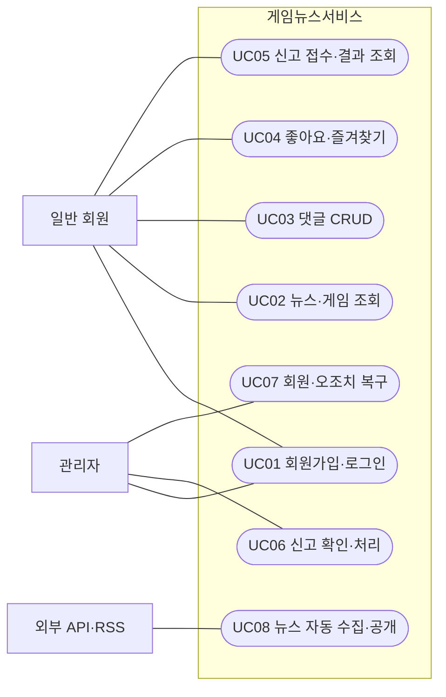
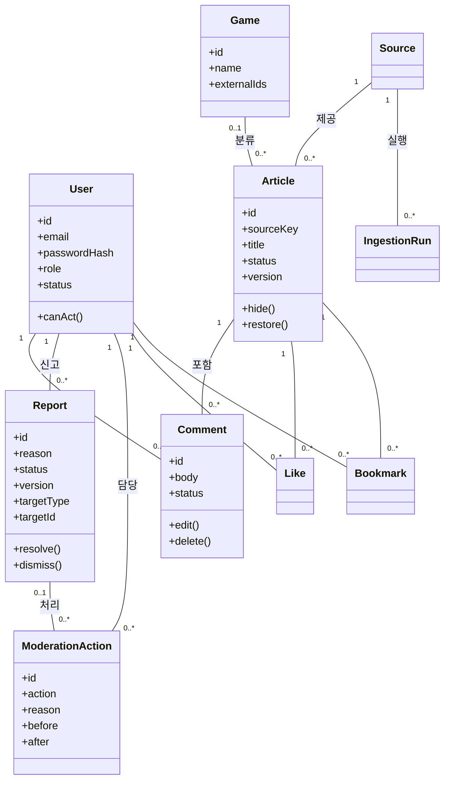
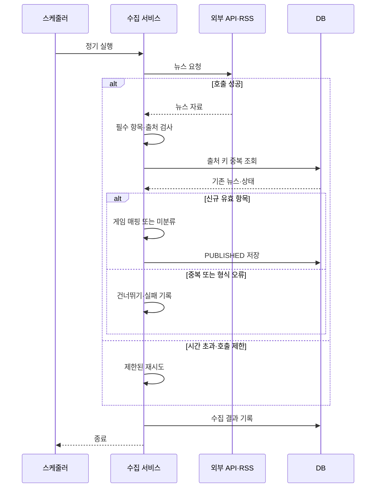
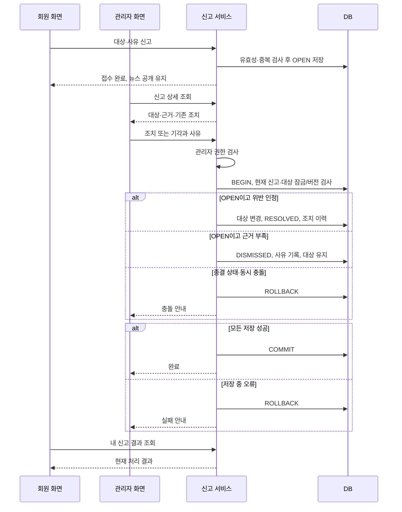

학번 : 202212949 이름 : 백경환

기준 계획: <mention url="https://app.notion.com/p/413bcc84e50e81bc9d6bd0260bf2ad69">구현 가능성 검토 및 개발·제출 계획</mention>

## 게임 뉴스 서비스 요구분석 및 UML 설계

| 제출 항목 | 작성 내용 |
| --- | --- |
| 프로젝트 제목 | 게임 뉴스 자동 수집 및 신고 기반 정보 서비스 |
| 작성자 | 학번 202212949 / 백경환 |
| 사용 LLM | OpenAI ChatGPT의 Codex 에이전트 |
| 대상 프로젝트 | 웹서비스설계 텀 프로젝트 |
| 설계 기준 | 자동 수집·공개 후 사용자 신고를 관리자가 확인하여 처리 |

### 1 요구분석서

여러 출처에 흩어진 게임 뉴스와 게임·회사 정보를 한곳에서 확인하고, 댓글과 즐겨찾기로 이용할 수 있는 웹서비스를 설계한다. 뉴스는 API·RSS에서 자동 수집하여 기본 검사를 통과하면 공개한다. 관리자는 뉴스를 사전에 승인하지 않고, 사용자가 신고한 내용과 근거를 확인한 후 숨김·분류 정정·회원 정지 또는 신고 기각을 수행한다.

### 이해관계자와 범위

일반 회원은 로그인 후 게임별 뉴스를 읽고 댓글·좋아요·즐겨찾기·신고 기능을 이용한다. 관리자는 신고 처리와 회원 상태 관리, 오조치 복구를 담당한다. 외부 데이터 제공자는 Steam API, IGDB API, RSS이며 가격 정보용 IsThereAnyDeal 연동은 확장 범위이다.

필수 범위는 인증, 뉴스 자동 수집·공개·조회, 댓글 CRUD, 좋아요·즐겨찾기, 신고와 관리자 사후 처리이다. 게임·회사 정보와 RSS 추가 연동은 확장하고, 가격 정보·AI 요약·트레일러 특성 추정은 핵심 기능 안정화 이후 검토한다. AI 자동 기사 작성과 관리자 사전 승인 기능은 제외한다.

### 기능 요구사항

| ID | 요구 기능 | 수용 기준 |
| --- | --- | --- |
| FR01 | 회원가입·로그인 | 중복 이메일 거절, 비밀번호 해시 저장, JWT 검증 |
| FR02 | 뉴스 수집·공개 | 허용 출처·필수 항목·중복 검사 후 자동 공개 |
| FR03 | 뉴스·게임 조회 | 공개 뉴스만 조회, 게임 필터·검색·페이지네이션 |
| FR04 | 댓글 관리 | 활성 회원 작성, 본인 수정·삭제, 관리자 신고 후 숨김 |
| FR05 | 좋아요·즐겨찾기 | 사용자·뉴스별 1건, 추가·취소·내 목록 조회 |
| FR06 | 신고 접수·조회 | 뉴스·댓글·회원 신고, 사유 필수, 내 처리 결과 조회 |
| FR07 | 신고 확인·처리 | 관리자만 숨김·분류 정정·정지 또는 기각 |
| FR08 | 상태 복구·이력 | 정지 해제·오조치 복구 시 사유와 담당자 기록 |

## 요구사항과 업무 규칙

### 비기능 요구사항

| ID | 영역 | 검증 기준 |
| --- | --- | --- |
| NFR01 | 보안 | 인증·역할·소유권을 서버에서 검사하고 API 키와 비밀번호를 저장소에서 제외한다. |
| NFR02 | 일관성 | 신고 종결·대상 변경·조치 이력 저장은 모두 성공하거나 모두 롤백한다. |
| NFR03 | 중복·동시성 | 유일 제약과 버전 검사/행 잠금으로 중복 수집·반응·신고 처리 충돌을 방지한다. |
| NFR04 | 장애 대응 | 외부 호출 실패·시간 초과를 기록하고 기존 저장 뉴스 조회를 유지한다. |
| NFR05 | 사용성 | 로딩·빈 목록·입력 오류·권한 부족·처리 충돌을 사용자에게 안내한다. |
| NFR06 | 배포·검증 | JCloud를 다른 컴퓨터에서 접속하고 핵심 규칙 자동화 테스트와 화면 검증을 수행한다. |

### 핵심 업무 규칙

BR01 뉴스는 기본 검사를 통과하면 PUBLISHED로 공개한다. 게임 연결이 불명확하면 미분류로 표시하고 특정 게임 목록에서 제외한다.

BR02 신고는 OPEN으로 접수한다. 신고 접수나 건수만으로 뉴스 숨김·회원 정지를 자동 실행하지 않는다.

BR03 관리자는 OPEN 신고만 처리한다. 확인 결과에 따라 RESOLVED 또는 DISMISSED로 종결하며 사유를 반드시 남긴다.

BR04 위반 뉴스는 HIDDEN으로 바꾼다. 오분류는 게임 연결을 정정하고 공개를 유지한다. 기각된 신고의 대상 상태는 바꾸지 않는다.

BR05 일반 회원은 다른 사람의 댓글을 수정·삭제하거나 관리자 조치를 실행할 수 없다. 정지 회원은 기존 JWT로도 보호 API를 이용할 수 없다.

BR06 동일 회원의 동일 대상 신고는 1건으로 제한한다. 좋아요·즐겨찾기는 각각 회원과 뉴스 조합별 1건이다.

BR07 재수집은 기존 숨김 상태를 덮어쓰지 않는다. 동시에 같은 신고를 처리하면 한 요청만 반영하고 나머지에는 충돌을 알린다.

BR08 오조치 복구는 관리자만 수행하며 이전 조치와 복구 사유를 기록한다. 이미 종결된 신고를 다시 OPEN으로 되돌리지는 않는다.

### 설계 및 검증 범위

React 화면, Java/Spring Boot REST API, 관계형 DB로 구성한다. 이 문서는 구현 전 설계이며 API 연동 성공이나 테스트 통과를 의미하지 않는다. 구현 시 실제 DB에서 권한 위반, 중복 요청, 동시 처리, 중간 실패 후 롤백을 검증한다.

## 유스케이스 다이어그램

시스템 경계는 게임 뉴스 서비스이다. 회원과 관리자는 서로 다른 역할로 표시하고, 공통 인증은 각 유스케이스의 사전조건으로 둔다. 서버 내부 스케줄러는 액터가 아닌 시스템 내부 구성요소이며 외부 API·RSS를 보조 액터로 표시한다.

그림 1. 회원은 서비스를 이용하고 신고를 접수한다. 관리자는 신고된 대상을 확인해 처리한다. 외부 데이터 제공자와 연결된 자동 수집은 사전 승인 없이 뉴스를 공개한다.

## 유스케이스 명세서 회원 기능

### UC01 회원가입 및 로그인

주 액터: 비회원·회원·관리자 / 사전조건: 가입 또는 로그인 화면 접근

기본 흐름: 1. 이메일·비밀번호 입력 → 2. 서버 입력·중복·계정 상태 검사 → 3. 가입 시 해시 저장, 로그인 시 자격 검증 → 4. 토큰 발급·이용 화면 이동

예외 흐름: 중복 이메일·잘못된 자격·정지 계정은 거절. 만료·위조 토큰은 보호 API에서 거절.

사후조건 및 요구사항: 유효 회원 계정 생성 또는 인증 성공. FR01

### UC02 뉴스 및 게임 조회

주 액터: 활성 회원 / 사전조건: 로그인 성공

기본 흐름: 1. 목록·검색·게임 필터 선택 → 2. 공개 뉴스 조회 → 3. 상세에서 출처·게임 정보·댓글 확인

예외 흐름: 숨김·없는 뉴스의 직접 주소 접근은 거절. 외부 수집 장애 중에도 기존 저장 자료 제공.

사후조건 및 요구사항: 공개 정보만 반환되고 DB는 변경되지 않음. FR03

### UC03 댓글 관리

주 액터: 활성 회원 / 사전조건: 공개 뉴스 존재, 수정·삭제는 본인 댓글

기본 흐름: 1. 댓글 입력 또는 본인 댓글 선택 → 2. 서버 상태·소유권·입력 검사 → 3. 저장/수정/삭제 상태 반영 → 4. 화면 갱신

예외 흐름: 빈 댓글·다른 작성자·숨김 뉴스·정지 계정 요청은 거절.

사후조건 및 요구사항: 새로고침 후 결과 유지, 타인 댓글 변경 없음. FR04

### UC04 좋아요 및 즐겨찾기

주 액터: 활성 회원 / 사전조건: 공개 뉴스 존재

기본 흐름: 1. 추가·취소 선택 → 2. 사용자와 뉴스 조합 검사 → 3. 저장 또는 제거 → 4. 상태·내 목록 갱신

예외 흐름: 중복 추가는 기존 상태 반환, 이미 없는 항목 취소도 성공 처리. 숨김 뉴스는 추가 불가, 기존 즐겨찾기 해제 가능.

사후조건 및 요구사항: 각 조합 최대 1건 유지. FR05

## 유스케이스 명세서 신고와 자동 수집

### UC05 신고 접수 및 결과 조회

주 액터: 활성 회원 / 사전조건: 신고 대상 존재, 본인의 동일 대상 신고 없음

기본 흐름: 1. 뉴스·댓글·사용자 신고 선택 → 2. 사유·근거 입력 → 3. 서버 대상·중복 검사 → 4. OPEN 저장 → 5. 내 신고 내역에서 결과 확인

예외 흐름: 사유 누락·잘못된 대상·중복은 거절. 다른 회원의 신고 내역 조회는 거절.

사후조건 및 요구사항: 신고 접수 후 대상 공개 상태 유지. FR06

### UC06 신고 확인 및 처리

주 액터: 관리자 / 사전조건: OPEN 신고, 유효 관리자 인증

기본 흐름: 1. 신고함 조회 → 2. 대상·원문·근거·기존 이력 확인 → 3. 조치와 사유 결정 → 4. 권한·현재 상태·버전 검사 → 5. 한 트랜잭션으로 대상 변경·신고 종결·이력 저장 → 6. 결과 표시

예외 흐름: 근거 부족은 DISMISSED, 대상 상태 유지. 동시·종결 신고 처리는 충돌 안내. 저장 중 실패는 모두 롤백. 이미 조치된 대상은 근거를 기록하고 종결.

사후조건 및 요구사항: 인정 시 RESOLVED, 기각 시 DISMISSED. 변경과 이력이 일치. FR07, NFR02·03

### UC07 회원 상태 및 오조치 복구

주 액터: 관리자 / 사전조건: 정지 회원 또는 숨김 뉴스와 기존 조치 이력 존재

기본 흐름: 1. 기존 조치 확인 → 2. 복구 사유 입력 → 3. 권한·상태 검사 → 4. 계정 ACTIVE 또는 뉴스 PUBLISHED와 복구 이력 저장

예외 흐름: 이미 복구된 대상·권한 위반은 거절. 마지막 활성 관리자나 자기 계정 정지는 금지.

사후조건 및 요구사항: 현재 대상 상태 복구, 기존 종결 신고와 과거 이력 보존. FR08

### UC08 뉴스 자동 수집 및 공개

주 액터: 시스템 자동 실행 / 보조 액터 외부 API·RSS / 사전조건: 활성 출처·게임 설정, 예약 실행 시각 도달

기본 흐름: 1. 스케줄러 호출 → 2. 외부 자료 수신 → 3. 필수 항목·출처·중복 검사 → 4. 게임 매핑 또는 미분류 → 5. PUBLISHED 저장 → 6. 수집 결과 기록

예외 흐름: 중복은 새 글 생성 안 함. 잘못된 형식은 실패 기록. 시간 초과·호출 제한은 제한된 재시도 후 종료. 숨김 글 재수집 시 숨김 유지.

사후조건 및 요구사항: 신규 유효 뉴스 자동 공개, 관리자 승인 불필요. FR02, NFR04

## 클래스 다이어그램

핵심 도메인 클래스와 연관 다중성을 표시한다. 화면·DTO·인증 라이브러리·선택 기능은 생략했다. 관계선은 연관 관계이며 화살촉은 탐색 방향을 뜻한다.

그림 2. Report.targetType과 targetId는 개념 표현이다. 실제 DB에서는 article_id, comment_id, reported_user_id 중 정확히 하나만 채우고 FK와 CHECK로 무결성을 보장한다. 뉴스·댓글·회원 각각은 신고 0..*건의 대상이 된다.

좋아요·즐겨찾기에는 (user_id, article_id), 뉴스에는 (source_id, external_key), 신고에는 신고자·대상 조합 유일 제약을 둔다. ModerationAction의 reportId는 오조치 복구 등 독립 이력을 위해 선택값으로 두고 기존 조치 참조도 기록한다.

## 순차 다이어그램 자동 수집과 공개

UC08의 정상 흐름과 수집 예외를 나타낸다. 수집기의 외부 통신은 DB 트랜잭션 밖에서 수행하고, 유효한 신규 항목 저장 시 공개 상태를 부여한다.

예외 분기: 중복 뉴스는 새로 만들지 않으며 HIDDEN 상태를 유지한다. 형식 오류는 저장 대상에서 제외한다. 외부 호출 실패는 제한된 재시도 후 실패 이력으로 남기고, 기존 뉴스 조회를 중단하지 않는다. 관리자 승인 요청은 없다.

## 순차 다이어그램 신고 확인과 사후 처리

UC05·UC06 중 뉴스 숨김 시나리오를 나타낸다. 신고 접수와 관리자 확인은 별도 시점에 이루어지며, 처리 시점의 상태를 다시 검사한다.

예외 분기: 근거 부족이면 DISMISSED로 종결하고 뉴스 공개를 유지한다. 일반 사용자 조치는 403으로 거절한다. 종결 신고·동시 충돌은 변경 없이 거절하며, 대상 변경 또는 이력 저장에 실패하면 전체 롤백한다.

## LLM 활용 기록 및 제출 확인

### 실제 대화에서 확인되는 요청과 반영 결과

| 단계 | 실제 요청 발췌 또는 요지 | 반영 결과 |
| --- | --- | --- |
| 초기 계획 | 노션의 PDF와 내용을 보고 구현 가능 여부와 진행 계획을 하위 페이지에 정리 요청 | 과제 조건, 기능별 가능성, 구현 단계와 검증 항목을 정리했다. |
| 운영 방식 보완 | “관리자가 직접하는 느낌보다 신고를 받고 확인해서 거르는 식으로 바꾸자” | 사전 승인 절차를 제거하고 자동 공개 후 신고 기반 사후 처리로 수정했다. |
| 제출 문서 작성 | 첨부 양식의 요구 항목을 맨 아래 작성하고 학번·이름 추가, PDF 및 노션 하위 페이지 저장 요청 | 요구분석, 유스케이스와 명세, 클래스, 순차 다이어그램을 작성했다. |
| 입력 파일 변경 | “docx파일로 변환했어 해당 사항 그대로 이 파일을 이용해 바꿔” | 변환된 DOCX의 기존 안내문을 유지하고 후속 작성 내용을 추가했다. |

### 설계 보완 및 검토 내용

LLM 초안에서 관리자 사전 승인 중심의 흐름을 사용자의 요구에 맞게 자동 공개·신고 기반으로 수정했다. 요구사항 ID와 유스케이스를 연결하고 신고 접수와 대상 숨김을 분리했다. 중복 신고, 동시 관리자 처리, 저장 중 실패 시 롤백, 숨김 뉴스 재수집 시 상태 유지 조건을 명세와 순차 흐름에 반영했다.

다이어그램은 이 문서의 설계 결과이며 구현 완료 증거가 아니다. 실제 API 호출, DB 트랜잭션 테스트, 배포 검증 결과는 개발 단계에서 별도로 기록한다.

### 프롬프트와 결과 캡처 제출 항목

원문 안내문의 단계별 프롬프트·결과 캡처는 실제 대화 화면으로 별도 첨부해야 한다. 위 표는 확인 가능한 대화의 텍스트 기록이며 화면 캡처를 대체하거나 재현한 이미지가 아니다. 요구분석, 유스케이스, 클래스, 순차 다이어그램 단계별 검토 화면을 캡처해 제출 자료에 첨부한다.

### 참고 자료

원문 과제 안내: 요구분석 및 다이어그램 작성.docx

프로젝트 계획: https://app.notion.com/p/413bcc84e50e81bc9d6bd0260bf2ad69

원본 프로젝트: https://app.notion.com/p/413bcc84e50e80c497b7f53ab3f5f8c6

사용 LLM: OpenAI ChatGPT의 Codex 에이전트. 세부 모델 버전은 별도로 확인하지 않았으므로 기재하지 않았다.
